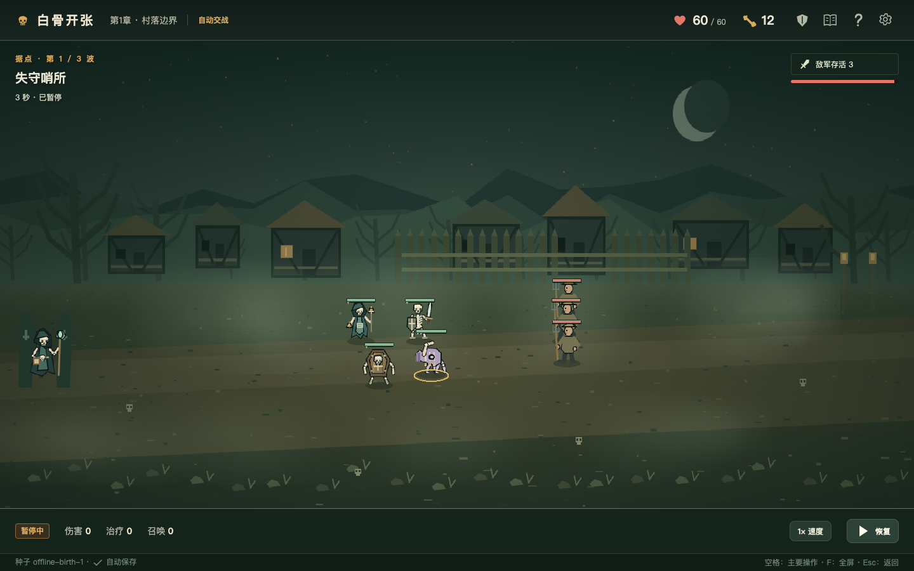

# 白骨开张

一款可完整通关的中文亡灵老虎机军团原型。先摇九宫格、动手改盘，再吸收和换壳培养亡灵，布阵开战。三章随机分叉地图包含36波战斗、商店、墓园、工坊和事件。



## 直接游玩

从 [GitHub Release](https://github.com/luhaobin-lab/whitebone-afterlife/releases/latest) 下载 `Whitebone_Prototype_v0.1.0.zip`，解压后双击其中的 `白骨开张.html`，用桌面浏览器打开即可。游戏代码、图形和合成音效均不依赖联网，不需要安装服务。

- 三种初始军团、6个符号家族、36种职业、72条训练专精。
- 36件机器/军团遗物、12种道具，以及尸毒、护盾、召唤、死亡爆葬、治疗、冲锋、暴击刺客和湿冷感电等机制。
- 3×3共8条线，同族一盘只出一名；多线决定出生职业，训练经验只提高Lv1–8。
- 初始4个阵位，可以用骨头扩到8个。正式士兵战后复起，临时召唤仅存在于当前战斗。
- 自动保存；设置里可导出/导入存档。不同浏览器和文件位置的自动存档可能不共用。

基本流程：选地图节点 → 拉杆 → 领取招魂结果 → 整理军团 → 进攻。鼠标点击操作；拖动兵牌到阵位。空格执行主要操作或暂停战斗，F切换全屏，Esc关闭弹窗。右上角提供图鉴、帮助和设置。

首领节点的三波必须全部获胜，任意一波失败均结束远征；普通/精英败退可在命匣仍有余量时继续下一节点。

## 本地开发

需要 Node.js 22.12+（或24+）与 npm。

```sh
npm ci
npm run dev
```

开发入口 `http://127.0.0.1:5173`。生产预览：

```sh
npm run build
npm run preview
```

生产入口 `http://127.0.0.1:4173`。生成单文件离线版本：

```sh
node scripts/package-game.mjs --status final --verify --evidence artifacts/offline/final
```

打包脚本只读取最近的 `dist`，不会替你重建。验证使用Chromium；首次环境需要 `npx playwright install chromium`。

## 验证

```sh
npm test
npm run balance -- --roundtrip --seeds 30 --strategy all --out artifacts/balance/shipping-30.json
npx tsx scripts/ui-campaign.ts --starter legion
node scripts/ui-edge.mjs
```

`ui-campaign`和`ui-edge`需要先启动4173生产预览。完整规则、仿真、存档、浏览器与离线验收边界见 [验证记录](docs/VERIFICATION.md)。测试截图和运行报告生成到本地 `artifacts/`，不纳入源码仓库。

初版 [游戏设计文档与数值表](docs/design/) 随源码提供；它们是设计快照，后续实装差异见 [变更记录](docs/BALANCE_LOG.md)。当前发布版使用领取结果的操作流程。源码中的即时出生领域接口与准备区扩展尚未接入发布界面。

这是功能完整的游戏原型。单局目标30–45分钟；真人时长、长期乐趣、更多硬件和浏览器尚待验收。已通过的自动化检查不等于商业发行认证。

## 结构

- `src/domain`：确定性战斗、盘面与经营规则。
- `src/content`：职业、遗物、道具、敌人及事件内容。
- `src/render`：Phaser战场与原创程序化图形。
- `src/ui`、`src/main.ts`：经营界面、音效和流程整合。
- `tests`、`scripts`：回归、战役策略和离线打包。
- `docs`：设计文档、数值表、规则接口和验证记录。

第三方框架许可随离线包附在 `licenses` 目录。项目图形为本原型程序绘制，未复制参考游戏的美术。
